# Report: identity "Die Halle"

Branch `identity/halle`, 2026-11-03, about five hours of autonomous work (start 18:16 UTC).
Decisions in `DECISIONS.md`, open points for the owner in `FOR_LUKAS.md`, rules in
`docs/DESIGN.md`, the decision record in ADR 024.

## What changed

- **Foundation.** All colours come from the club colour (`lib/color.ts`): the stage is the raw club
  colour, the sidebar its deep shade, the page a paper tinted towards it; resin yellow marks the
  one thing per screen that needs attention; the current place is marked in white. Tested for six
  club colours in light and dark. Barlow and Barlow Condensed replace Archivo (self-hosted, OFL).
  6 to 8 px radius instead of soft panels and pills. Own icons for navigation and handball objects.
- **Stage and workbench.** `Stage` (club colour, full bleed, court frame from `packages/court`) at
  the top of Übersicht, Saison, Spiel, landing, sign-in and onboarding; everything else is a calm
  workbench with match-sheet tables (`.sheet`).
- **Voice.** `lib/voice.ts` states one thing from the data (runs, goals against expected goals,
  defence, record, match margin), neutral when the data is thin, estimates marked. Texts in de-CH,
  en, fr.
- **Saison.** Statement, last result with count-up, goals as clips (pre-filtered scene search), a
  stat strip with one marked figure against reference values, form with result edges, bests,
  scorers, chart from three matches, sheet table.
- **Übersicht.** Coach: the next match when close (time, opponent, prepare, live) or the last
  result and its statement; below: what stands out (one signal on the first weakness), up next,
  ask the data. Player: next date with reply on the stage. Parents: calm, no stage.
- **Spiel and Spiele.** Match header as scoreboard rows (team, goals; our row in full strength),
  analysis done said on the stage; fixture list with the score as the hero.
- **Kader.** A team sheet: shirt numbers in the club colour, name, position, hand, account.
- **First impression.** Landing and sign-in on the product stage; the onboarding band takes the
  club colour and name live while they are entered.
- **Match card.** A 4:5 PNG drawn in the browser (club, team, date, score, result, two figures,
  court), staff only, demo data labelled.
- **Details.** Live page with scoreboard type; 2FA notice only until 2FA is set up and closable for
  the session; status page without a coloured side border; German file picker in the squad import.
- **Guard rails.** `design-lint.test.ts` now also forbids soft panels, pills, coloured side
  borders and the sparkle symbol; `voice.test.ts`, contrast tests for stage, deep, signal and paper.

## Reviews (fresh agent, screenshots only)

1. After slice 3: eight findings (cropped court, yellow with two meanings, badge soup in the
   fixture list, match header without team mapping, generic squad form, 2FA banner height, mobile
   hero order, duplicate upload). All addressed except a squad grid of empty numbered shirts, which
   would show invented placeholders.
2. Final: heroes read as premium and handball-specific; findings on the squad page, mobile hero
   order, stray court bars, the warning tint for a yellow club and the sign-in court were fixed in
   round 2. Kept on purpose: the demo tag (P3 honesty) and the reference values for the marked
   figure (named on the page).

## Tests

- Vitest: web 73 (incl. design lint, voice, colours, navigation, match card), court 18,
  client-core 7, tactics 7, mobile 4, site 13; all green.
- Playwright against the production image: 31 passed, 19 skipped (desktop-only flows in the
  mobile project), axe without findings, web vitals within budget. Specs changed only where the
  design changed on purpose (season chart from three matches, match count in the stage line,
  greeting in the stage line, landing without a court image).
- Lint and type checks green in all packages; budgets: start page 149 kB (250), largest route
  234 kB (300).

## Before and after

| | Before | After |
|---|---|---|
| Saison | 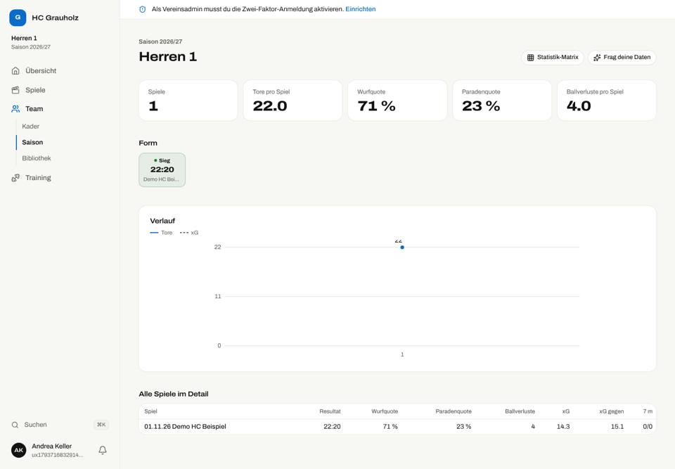 | 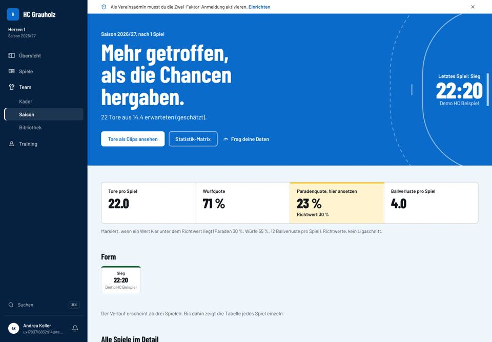 |
| Übersicht | 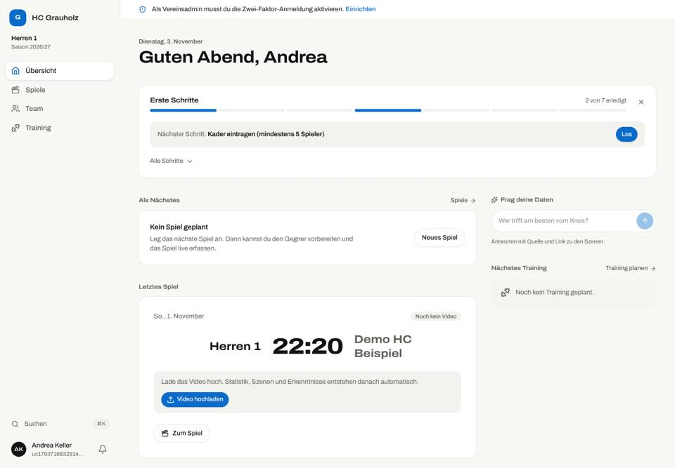 | 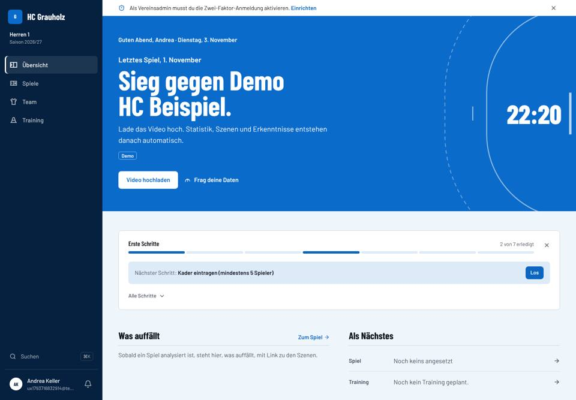 |
| Spiel | 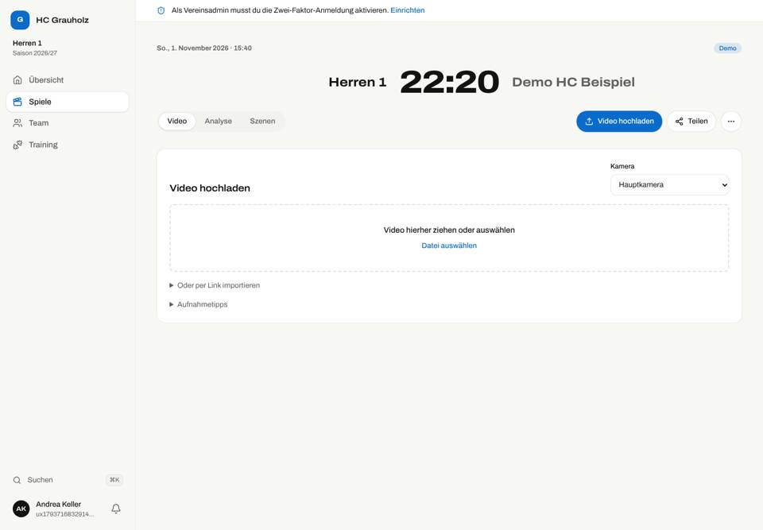 | 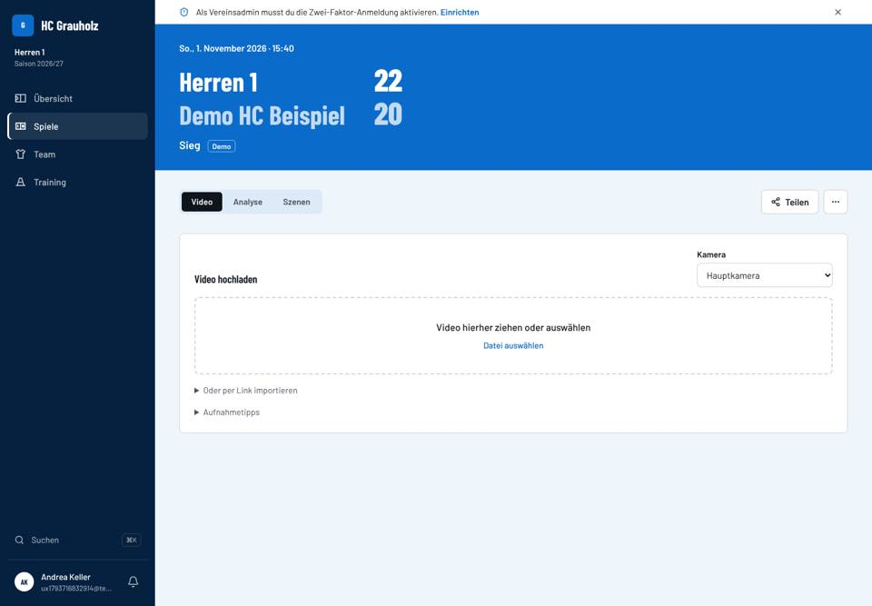 |
| Spiele | 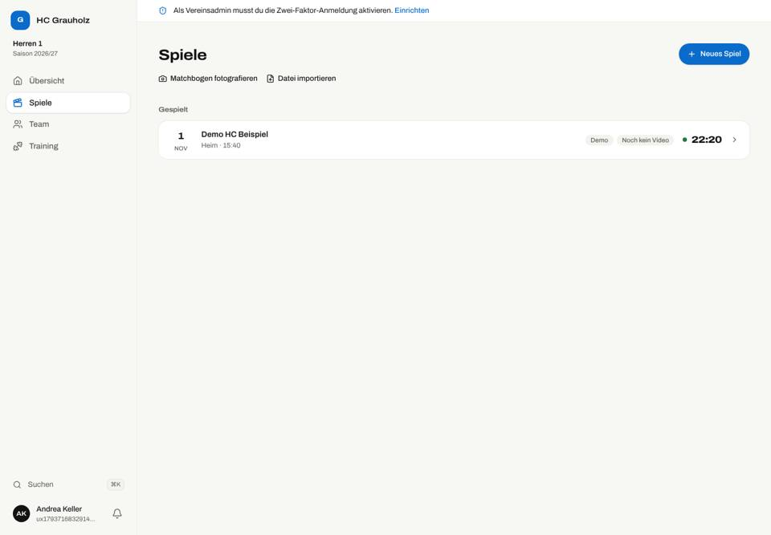 | 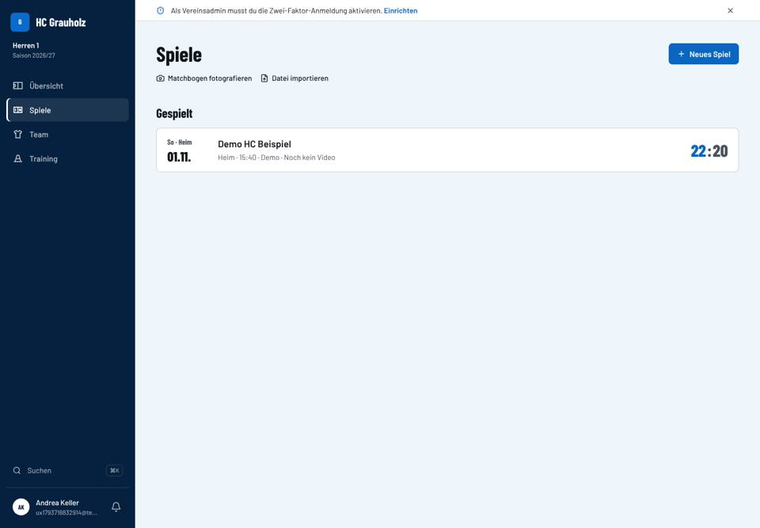 |
| Übersicht, Handy | 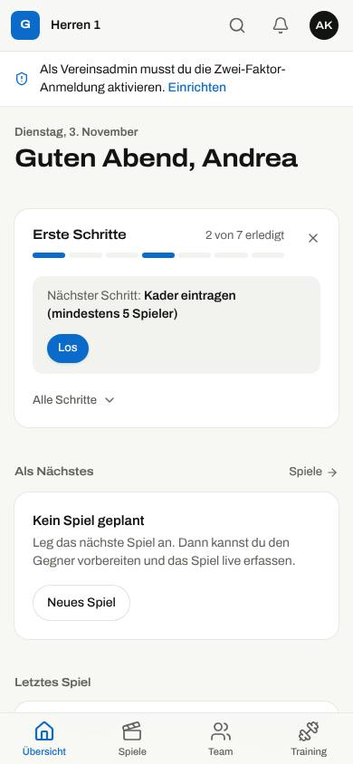 | 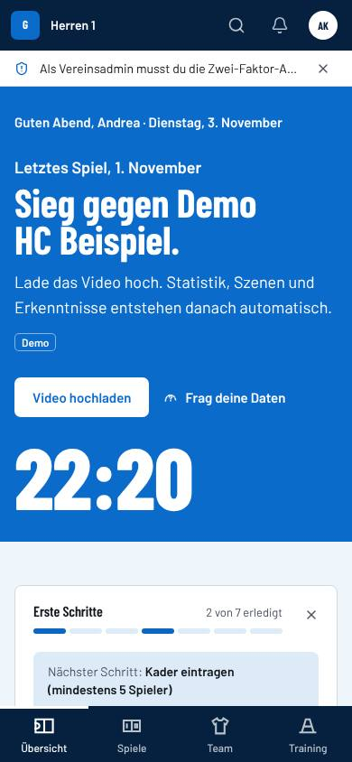 |
| Saison, dunkel | 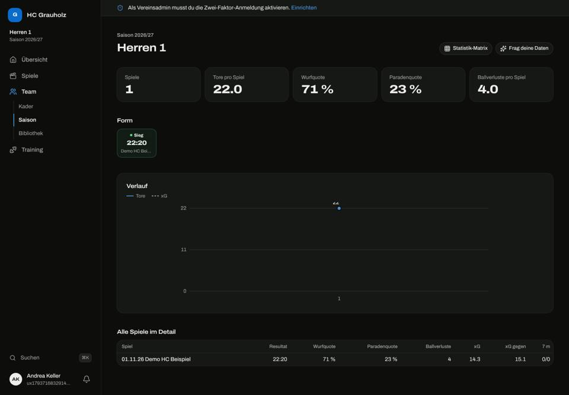 | 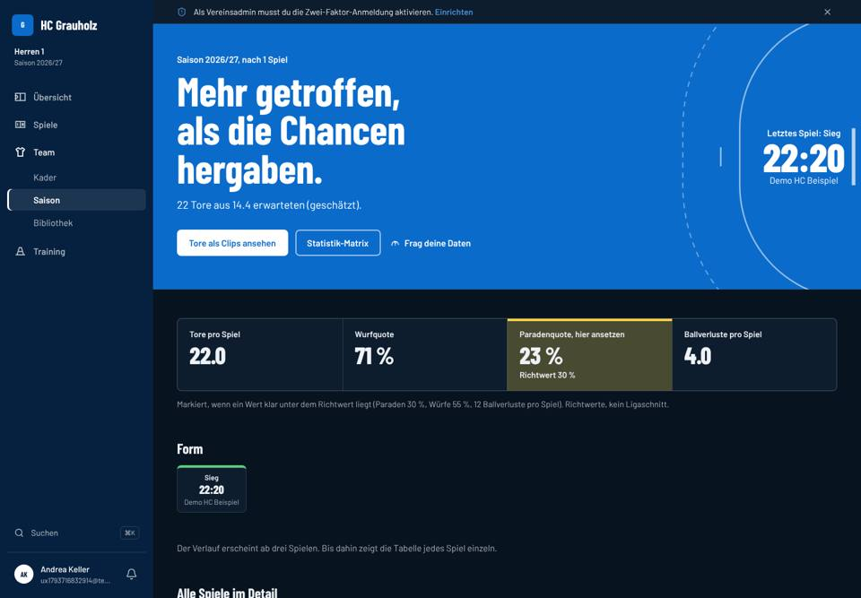 |

Six club colours: 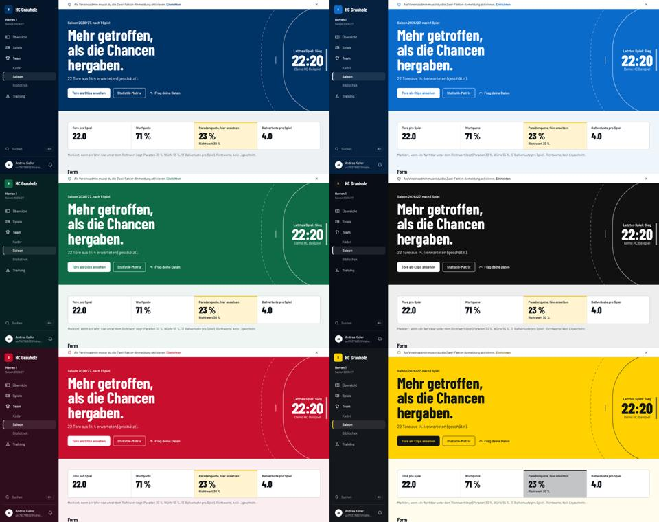

Kader: 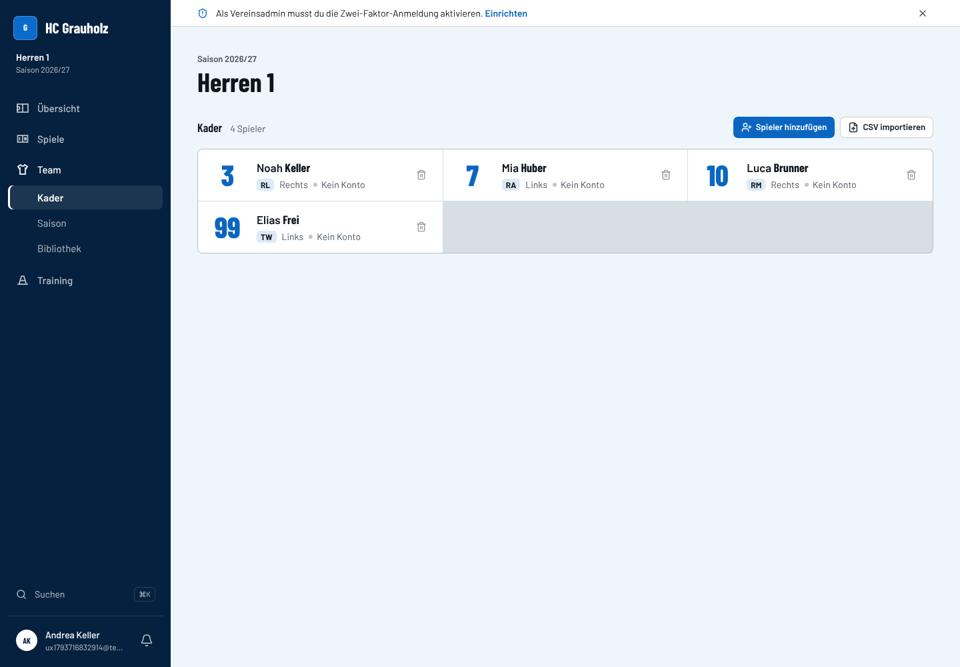 · Matchkarte: 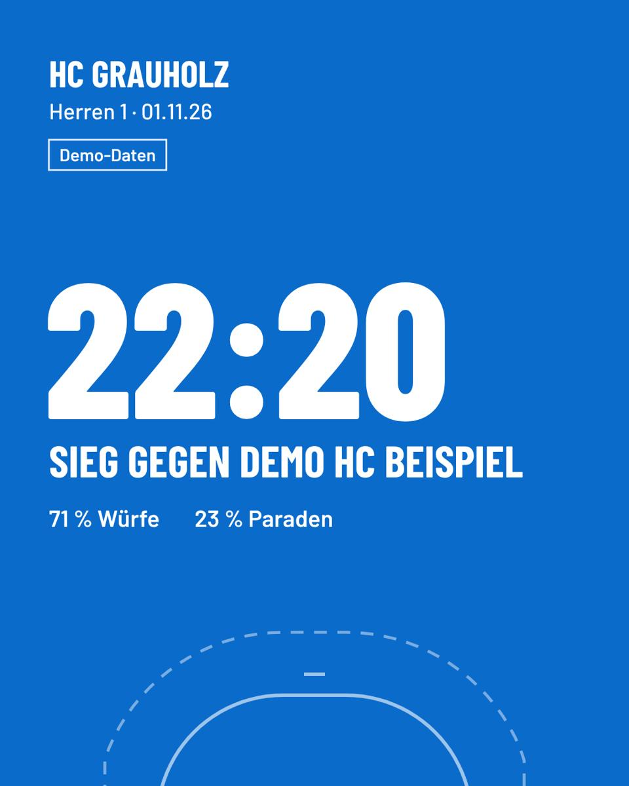

## Open

See `FOR_LUKAS.md`: merge decision, reference values, coach notes in handwriting, video frames on
the stage (consent), marketing site and Expo app in the new identity, usability sessions (Q-UX-1).
