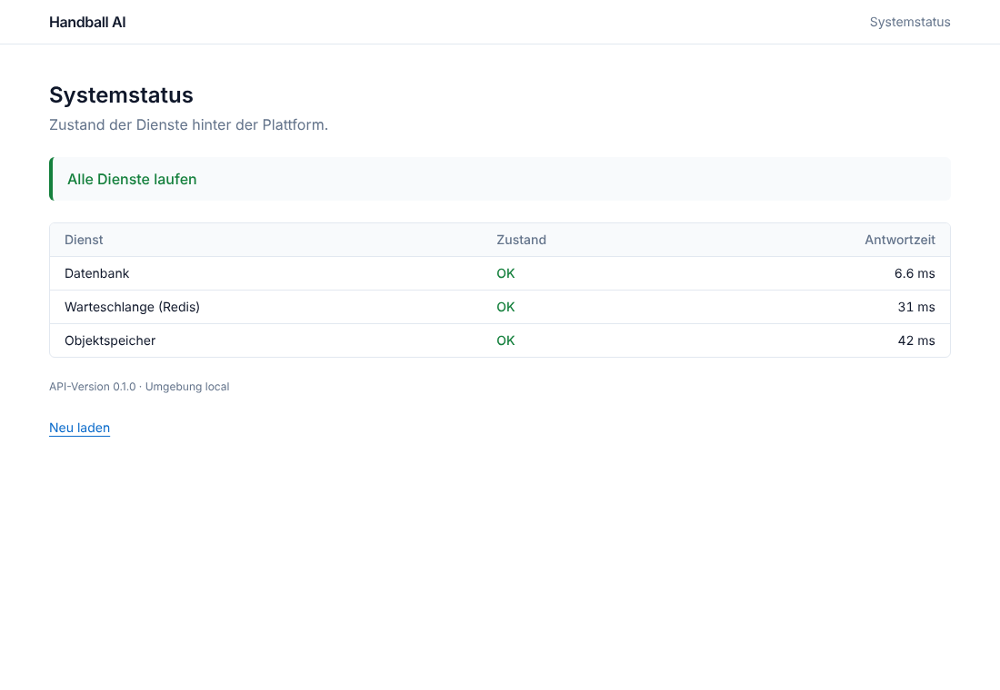

# M0 Foundation: report

Date: 2026-11-02 · Status: **done, waiting for "weiter"**

## Acceptance criteria
| Criterion | Result |
|---|---|
| `docker compose up` starts all services | ✅ postgres, redis, s3, mailpit, migrate (one-shot), api, worker, gpu-worker, web all healthy |
| `make test` is green | ✅ 43 Python tests (coverage 94 %, gate 80 %), 11 Vitest tests |
| A health page is reachable | ✅ `http://localhost:3000/status` (web), `/healthz`, `/readyz`, `/v1/health` (API) |

## What was built
- **Monorepo**: uv workspace (Python 3.12) + pnpm workspace (Node 22), Makefile as entry point (ADR 007).
- **API** (`apps/api`): app factory, settings (`HB_*` env), structlog JSON logs with request id, RFC 9457
  problem responses for all errors, CORS, basic security headers, liveness/readiness with per-component
  latency (Postgres, Redis, S3), SQLAlchemy 2 async base with `EntityMixin` (UUID, timestamps) and
  `TenantMixin`, Alembic (async) with baseline migration (pgcrypto, citext, `app_current_org()` for RLS),
  bucket bootstrap, OpenAPI export, optional Sentry.
- **Worker** (`apps/worker`): RQ worker with healthcheck; `PipelineGraph` (declared inputs/outputs, topological
  order, cycle/duplicate/missing-input validation, downstream recompute set, cache keys) and the full v1 stage
  declaration from BRIEF 7.2. Example: a correction recomputes only `metrics → insights → clips`.
- **GPU worker** (`apps/gpu-worker`): `GpuBackend` protocol, `LocalBackend` with GPU-seconds and CHF cost
  accounting, explicit not-implemented adapters for runpod/modal/k8s, registry by config (`HB_GPU_BACKEND`).
- **Court** (`packages/court`): one JSON spec → generated geometry (lines incl. 6 m/9 m arcs, 26 calibration
  keypoints) used by Python and TS; attack-direction normalisation and distance-to-goal; CI freshness check.
- **Web** (`apps/web`): Next.js 15.5, TS strict, Tailwind 4 with light/dark tokens, TanStack Query provider,
  next-intl (de-CH default, en, fr), CSP and security headers, home page with court drawing, status page,
  `/api/healthz`; typed API client generated from OpenAPI (`packages/api-client`).
- **Quality gates**: ruff, mypy strict, import-linter (module boundaries), ESLint (0 warnings), tsc strict,
  madge (no circular imports), pre-commit (incl. gitleaks, large-file guard), Playwright + axe (WCAG 2.2 AA tags).
- **CI** (`.github/workflows/ci.yml`): Python, migrations (`upgrade`, `alembic check`, downgrade/upgrade), web
  (lint, types, tests, build), container builds + Trivy scan, full-stack job (compose, integration, Playwright),
  preview deploy job (disabled until hosting is decided).
- **Docs**: PLAN, ARCHITECTURE, OPEN_QUESTIONS, ADR 001 to 007, ML licence table, golden-set manifest stub.

## What was tested (and how)
- `make test`: unit tests incl. error format, readiness ok/degraded/timeout, DB engine lifecycle, bucket
  bootstrap idempotency, pipeline graph rules, RQ round trip with fakeredis, GPU backends, court geometry (Py + TS),
  locale resolution, health view mapping.
- `make test-integration` against the running stack: API readiness with real Postgres/Redis/S3, job round
  trip through the real `worker` (default queue) and `gpu-worker` (gpu queue) containers: 3/3 passed.
- `make test-e2e`: 6/6 passed (Desktop Chrome + Pixel 7): home, status (all OK), liveness, axe without violations.
- `alembic check`: models and migrations in sync. `pre-commit run --all-files`: all hooks pass.
- **Not yet run**: the GitHub Actions workflow itself (no remote repository yet). Trivy scan only runs in CI.

## Decisions
- RQ + own pipeline graph (ADR 001), hosting in CH proposed (ADR 002, needs decision), Apache-2.0 detectors in
  production, no Ultralytics in product images (ADR 003), visx for charts (ADR 004), app scoping + Postgres RLS
  (ADR 005), **SeaweedFS instead of MinIO** locally because MinIO no longer publishes community images (ADR 006),
  uv + pnpm + Makefile (ADR 007).
- Next.js pinned to 15.5 as the brief says, although 16 exists (Q-INFRA-5).
- Problem type URIs use `urn:handball-platform:problem:*`; no product domain is hard-coded because the working
  title is close to the competitor handball.ai (Q-PROD-1).
- Dockerfiles accept an optional build secret `extra_ca` for TLS-intercepting proxies; the local override is
  `compose.override.example.yaml`.

## Open / not in M0
- `ml/eval/bench.py` and `run.py`: no pipeline stage exists yet, they start in M3 (no fake numbers).
- OpenTelemetry tracing and metrics: hooks planned in M1/M2 alongside the first real endpoints; Sentry is wired (opt-in).
- `make seed` is a placeholder until M1 (needs the data model).
- CUDA image (`Dockerfile.cuda`) in M3.
- Remote repository, CI secrets and the first green CI run on GitHub.
- See `docs/OPEN_QUESTIONS.md`, especially Q-DATA-1 (test videos), Q-DATA-2 (paper report schema), Q-INFRA-1 (hosting).
