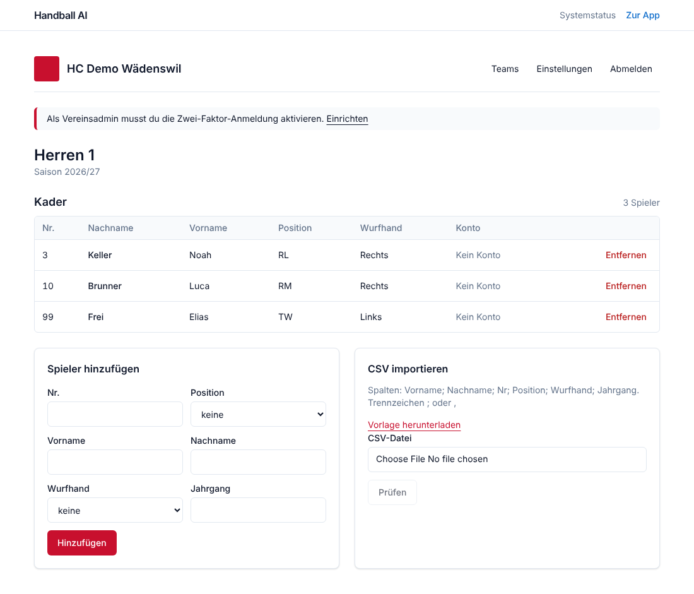

# M1 Accounts, tenants, roster: report

Date: 2026-11-02 · Status: **done, waiting for "weiter"**

## Acceptance criteria
| Criterion | Result |
|---|---|
| A new user creates club, team and roster in under 5 minutes | ✅ Playwright drives the real UI: register, club with logo and colours, team, 2 players by hand (incl. duplicate-number error), 3 by CSV, invite a player, open the team. Measured **7.5 s** of machine time; a human needs roughly 2 to 3 minutes for the same steps. |
| Role tests are green | ✅ Policy matrix: **23 endpoints × 7 roles = 161 checks** (org admin, coach, analyst, player, goalkeeper, guest, member of another club), plus 401 for anonymous calls. A deliberately broken rule was caught (mutation check). |

## What was built
**Backend**
- Data model + migration 0002: users, sessions, magic-link tokens, organisations, org memberships, teams,
  seasons, team memberships, players, roster entries, invitations, consents, audit log. Enums as
  VARCHAR + CHECK, all tenant rows cascade on organisation deletion.
- **Row Level Security** on all tenant tables with `FORCE`; the API now runs as the non-superuser role
  `handball_app`. Two explicit, audited system paths (org creation, invitation lookup by token).
- Auth (ADR 008): register, login, logout, magic link, TOTP (setup, enable, disable, login step),
  Argon2id, hashed opaque sessions, signed double-submit CSRF + Origin check, rate limits, startup guard
  against dev secrets in staging/production.
- Policy layer: one role × action table (`docs/policy-matrix.md` generated from it), 2FA requirement for
  org admins after a 14-day grace period.
- Organisations (incl. logo upload with magic-byte check, PNG/JPEG/WebP ≤ 1 MB), teams (current season
  created automatically, `players_see_team_stats` off by default for youth teams), seasons, members.
- Roster: players + roster entries per season, unique active jersey numbers, CSV import (`;`/`,`, UTF-8
  BOM or Windows-1252, German/English/French headers, position and hand aliases, dry run with row errors).
- Consents per player (video analysis, identification; parent/guardian/self, document reference, revoke).
- Invitations by e-mail (org admin or team role, optional link to a roster player), preview, accept for
  new or existing accounts, revoke, e-mail-address binding.
- E-mail port (ADR 009): SMTP to mailpit locally, de-CH/en/fr templates.
- Audit log for registrations, logins, 2FA changes, org/team/roster/consent/invitation changes.

**Frontend**
- UI primitives (button, field, select, checkbox, card, alert, empty state), club colour as accent with
  automatic contrast fallback for light colours (WCAG 3:1).
- Same-origin `/v1/*` proxy, typed client with CSRF middleware, server-side client with cookies.
- Pages: login (password, magic link, TOTP step), register (also via invitation), magic-link landing,
  invitation page, 4-step onboarding wizard, club home with teams, team roster (add, remove, CSV import with
  preview, template download), settings (club data and logo, members, invitations, 2FA with QR code).
- Route guard via middleware, safe `?next=` redirects, all texts in de-CH/en/fr.

## Tests
| Suite | Result |
|---|---|
| Python (pytest, real Postgres) | 89 passed, coverage **95 %** (gate 80 %) |
| Policy matrix + cross-tenant (API and direct SQL as `handball_app`) | green |
| Query count | team list uses a constant number of queries for 1 or 5 teams (no N+1) |
| Vitest | 20 passed: helpers, i18n key parity, every translation key used in code exists, no long dashes, no "ß" in de-CH |
| Playwright (Chromium desktop + Pixel 7) | 14 passed, axe (WCAG 2.2 AA tags) without violations on login, onboarding steps, roster, invitation and settings pages |
| Migrations | upgrade, `alembic check`, downgrade and upgrade again |

The full-flow E2E test also covers: invitation mail read from mailpit, invited player registers and only
sees the roster read-only, 2FA set up in settings and required on the next login, magic-link sign-in.

## Decisions
- ADR 008 (auth and sessions), ADR 009 (e-mail: SMTP port, Postmark proposed).
- 2FA for org admins is enforced after a grace period instead of during onboarding (Q-AUTH-2).
- Org membership row for every club member plus team roles; org admins act in every team.
- Denied access to resources of another club answers 404 (no existence leak); missing permission inside the
  own club answers 403.
- The browser talks to the API only through the web origin (first-party cookies, strict CSP).

## Open / not in M1
- Google and Apple sign-in (optional in the brief, Q-AUTH-1).
- Session list ("signed-in devices"), password reset by mail (magic link covers lost passwords for now).
- OpenTelemetry tracing: still open, planned with M2 when uploads and jobs need traces.
- `make seed` with demo matches comes in M2 (needs matches).
- Parent accounts for youth consent (Q-LEGAL-2).
- New open questions Q-AUTH-1/2, Q-ROLES-1/2/3 in `docs/OPEN_QUESTIONS.md`.
