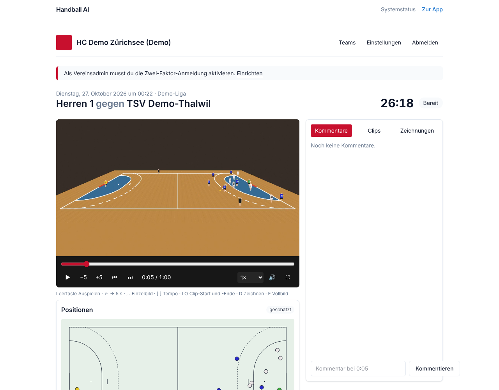

# M3 Pipeline skeleton, calibration, detection, tracking: report

Date: 2026-11-03 · Status: **done with documented gaps** (continuing with M4)

## Acceptance criteria
| Criterion | Result |
|---|---|
| A test video runs end to end | ✅ Upload, ingest (worker), analysis (GPU worker on CPU), positions in the player. Playwright covers it with a synthetic 30 s match (~1 min wall time incl. upload). `make seed` loads two 60 s demo matches through the same pipeline. |
| Positions in the player are plausible | ✅ on synthetic footage (mean calibration error 0.04 to 0.18 m, foot position error 0.4 to 0.5 m). Not yet verified on real footage (no videos yet, Q-DATA-1). |
| Metrics and runtime per stage in the report | ✅ below and in `docs/perf/eval-m3.md`, `docs/perf/bench-m3.txt` |

## Metrics (synthetic golden set, 3 camera positions, 60 s each, heuristic detector)
| metric | mean | target (BRIEF 10.3) |
|---|---|---|
| calibration error | 0.115 m | < 0.5 m ✓ |
| detection recall / precision (1 m) | 0.62 / 0.76 | mAP50 >= 0.95 ✗ |
| MOTA / IDF1 | 0.38 / 0.35 | HOTA >= 0.60 ✗ |
| team assignment per track | 0.90 | >= 0.97 ✗ |
| runtime (CPU, 4 cores, no GPU) | 0.47 x real time, 60 min match in ~28 min | <= 45 min on an L4 ✓ |

The best camera position (centre balcony) reaches recall 0.71, MOTA 0.58, IDF1 0.44. The low, off-centre
camera is clearly worse (occlusions), which matches the filming rules in BRIEF 7.5. **Why the gaps**: no
trained detector or ReID model could be obtained here (ADR 012). The ONNX detector path is implemented and
tested with a real ONNX graph; plugging in an RT-DETR-class model is configuration plus a model card.

## What was built
- `packages/vision`: synthetic generator with ground truth and CLI, calibration (auto + manual), background
  detector, ONNX detector, court-plane tracker with tracklet stitching, team assignment by kit colours,
  CLEAR MOT / IDF1 / detection / team metrics, streaming pipeline (PyAV, no frames on disk) with timings.
- `packages/jobkit`: progress reporter and storage helpers shared by both workers.
- GPU worker job `run_analysis` (stages 2 to 5): Parquet + 30 s float32 chunks, results to the API.
- API: migration 0005 (calibrations, tracks with source and pipeline version, analysis metadata), analysis
  starts automatically after ingest of the main camera, endpoints for analysis status, binary track chunks and
  manual calibration (re-runs the analysis as `user_correction`). A failed analysis keeps the video playable.
- Web: mini court (canvas, own animation loop, lazy chunk loading) synced to the video, analysis panel with
  "geschätzt" badge, calibration source and confidence, Demo badge on demo matches; the workspace no longer
  re-renders on every video frame.
- `ml/eval/run.py`, `ml/eval/bench.py`, `make eval`, `make bench`, `make seed`.

## Tests
- Vision: 12 (geometry, generator, calibration incl. failure cases and manual, detector, crossing players,
  occlusion bridging + stitching, team assignment, metrics, ONNX plumbing, full pipeline on a rendered video).
- GPU worker: analysis job end to end on a synthetic video, manual points, failure reporting.
- API: analysis flow (auto start after ingest, results, chunks, manual calibration, failure keeps video).
- Playwright: match flow now waits for the mini court and checks the analysis panel.

## Open
- Trained detector/keypoint/ReID models (needs data access and licences, ADR 003, Q-ML-2).
- UI for manual calibration (the API endpoint exists; click-on-frame dialog follows).
- Auto-follow cameras (homography per frame) and lens distortion: not implemented (fixed camera only).
- Ball detection (stage 8) not started.
